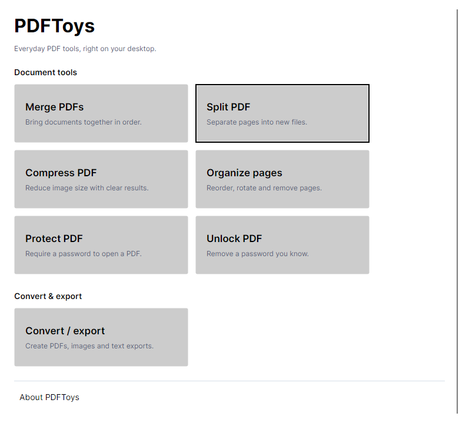

<p align="center">
  
</p>

<h1 align="center">PDFToys</h1>

<p align="center">
  Everyday PDF tools: merge, split, and manage PDFs from File Explorer.
</p>

<p align="center">
  <a href="https://github.com/mosaad-dev/PDFToys/releases/latest">Download for Windows</a>
  ·
  <a href="#features-and-quick-start">Features</a>
  ·
  <a href="#building-from-source">Build from source</a>
</p>

<p align="center">
  
</p>

## Installation

PDFToys runs on **64-bit Windows 10 or later**. Download the installer or portable ZIP from the [latest release](https://github.com/mosaad-dev/PDFToys/releases/latest). Both include the .NET runtime.

Run the installer to add PDFToys to the Start menu and the classic Explorer context menu. For the portable version, extract the ZIP and run `PDFToys.App.exe`; Explorer integration requires installation or manual registration.

## Features and quick start

PDFToys can merge, split, compress, protect, and unlock PDFs; reorder, rotate, and preview pages; convert files to PDF; and export PDFs as images or Markdown.

To merge PDFs:

1. Open PDFToys and choose **Merge PDFs**.
2. Add at least two PDFs and arrange them with drag-and-drop or the ordering buttons.
3. Choose **Merge files**. Files from the same folder save beside the inputs; otherwise, choose an output location. Open the saved PDF from Results.

Tools run in the background with progress and cancellation. Results let you open outputs, show them in File Explorer, copy paths, and retry failed files.


## Limitations

- **Compression** recompresses embedded images and may leave a PDF unchanged. See the [compression guide](docs/COMPRESSION.md) for supported formats and limitations.
- **Document features:** some operations refuse signed PDFs or features they cannot safely preserve, such as forms, bookmarks, and attachments.
- **Markdown export** extracts text without OCR or page-layout reconstruction.
- **Office conversion** requires the corresponding desktop version of Word, Excel, or PowerPoint. Close that application before converting its documents.

## Building from source

Developer requirements:

- .NET 10 SDK compatible with `global.json` for the app and tests.
- Visual Studio 2022 C++ build tools with ATL support for the shell extension.
- PowerShell 7 and Inno Setup 6 for release packaging.

Build the app before running tests so Office-worker tests can find its executable:

```powershell
dotnet build src/PDFToys.App/PDFToys.App.csproj -c Release
dotnet test tests/PDFToys.Core.Tests/PDFToys.Core.Tests.csproj -c Release
dotnet test tests/PDFToys.App.Tests/PDFToys.App.Tests.csproj -c Release
```

## Publishing and packaging

Run the release build from PowerShell 7:

```powershell
.\scripts\build-release.ps1
```

This runs tests and package checks, then creates an installer, portable ZIP, dependency notices, checksums, and a manifest under `artifacts/releases/<version>`. Set the version in `VERSION`. Use `-MsBuildPath` or `-IsccPath` if the build tools are not found automatically.

The **Build release candidate** workflow in [GitHub Actions](.github/workflows/release.yml) runs the same build manually. Publishing a GitHub Release is a separate step.

## Developer shell-extension setup

The installer handles Explorer registration automatically. For a manual build, run the release build first, then register the packaged DLL from an elevated PowerShell session:

```powershell
.\scripts\register-shell-extension.ps1 -DllPath ".\artifacts\package\PDFToys.ShellExtension.dll"
```

To unregister:

```powershell
.\scripts\register-shell-extension.ps1 -Action unregister -DllPath ".\artifacts\package\PDFToys.ShellExtension.dll"
```

## Security and data handling

- **Local processing:** PDF operations run locally; Office conversion uses the installed Office application.
- **Output files:** new copies are the default, with unique names for existing outputs. Explicit Protect/Unlock replacement keeps a recovery backup; Results shows its location.
- **Cancellation:** completed outputs remain available when a later file fails or processing is cancelled.
- **Local data:** settings are stored in `%LocalAppData%\PDFToys\settings.json`; Explorer headless-operation logs are in `%LocalAppData%\PDFToys\logs`.

## Troubleshooting / reporting issues

- **Explorer menu missing:** on Windows 11, choose **Show more options**. Reinstall PDFToys if the classic menu is still missing.
- **Context-menu operation fails:** check `%LocalAppData%\PDFToys\logs` for the latest diagnostic log.
- **Report a bug:** open a [GitHub issue](https://github.com/mosaad-dev/PDFToys/issues) with your PDFToys/Windows versions, reproduction steps, and relevant errors. Remove private file paths before sharing logs.

## Changelog and license

See the [changelog](CHANGELOG.md) for release history. PDFToys is licensed under [Apache 2.0](LICENSE); dependency attributions are listed in [NOTICE](NOTICE).
