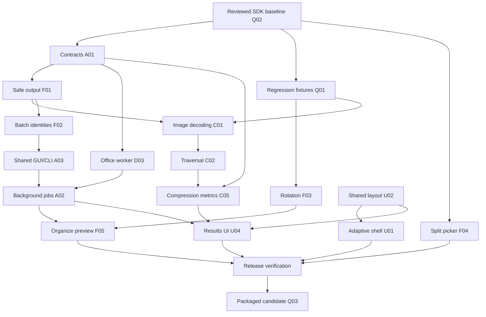

# PDFToys 0.2.0 implementation plan

Prepared 19 October 2026 from the [next-release backlog](NEXT_RELEASE_BACKLOG.md) and the current primary checkout. Status: **plan ready; implementation has not started**.

## Release objective

Ship a Windows release in which compression preserves supported content, output writes protect existing files, long operations leave the app responsive, and every existing tool has a complete input-to-result workflow.

The plan contains **18 implementation branches** and uses **four concurrent agents: one integration lead plus three implementation workers**. The 48-item backlog remains the longer-term roadmap. This plan selects a bounded release from it; it does not schedule all 48 items into 0.2.0.

## Scope decisions

### Included in 0.2.0

- Reliable compression of JPEG and common 8-bit RGB/grayscale Flate/predictor image streams; explicit preservation/skipping of unsupported or sensitive image types; nested-resource traversal and shared-object deduplication.
- Honest compression outcomes and statistics, including no useful reduction and skipped-image reasons.
- Safe candidate writes, collision-resistant naming, mandatory recovery protection for replace-original, and complete output manifests.
- Same-basename batch fixes, preservation of existing page rotations, a working Split picker, and previews that match pending rotation.
- A shared execution path for GUI/CLI conversion and export, background processing, stage/file/page progress, and cancellation at safe boundaries.
- A separate Office conversion execution path that preserves STA requirements and prevents unbounded UI hangs.
- Adaptive tool layouts, consistent states/actions, and per-file result actions.
- Regression coverage and a reproducible packaged release candidate.

### Follow-up scope

Lossless-engine adoption, effective-DPI downsampling and new compression profiles, target-size compression, before/after quality comparison, page-thumbnail editing, undo/multiselection, OCR, Windows 11 main-menu integration, scan cleanup, true redaction, and additional document-editing tools remain in later releases.

For 0.2.0, the existing Standard/Maximum presets must be described as lossy image recompression, not as guaranteed size targets or a lossless mode. Unsupported content must remain intact with an explanation. A no-change result must not claim that its input was successfully reduced.

### Compatibility checks required before shipping

Focused checks from D01 and Q05 are part of release validation, even though their full roadmap branches are deferred: identify document features affected by page-copy operations, check signatures/encryption handling, measure large-file behavior, and accurately describe limitations. A demonstrated data-loss defect in an advertised workflow becomes release-blocking. Do not mark the complete D01/Q05 backlog items finished after these limited checks.

## Agent staffing

Four is the recommended peak team size and fits the four available concurrent-agent slots. One agent could implement the work sequentially; four allows three distinct implementation areas while retaining an integration owner. A fifth agent is unnecessary for this release plan and would compete for shared contracts and files. Review and test work are assigned across the same team as implementation lanes finish.

| Agent | Role | Primary work | Later work / review |
| --- | --- | --- | --- |
| Lead | Integration, shared contracts, output safety, delivery | Q02, shared Q01 fixture conventions, A01, F01; approve interfaces, apply small DI/factory integration patches | Q03, full-build integration, output-safety review, release evidence and final verification |
| Worker 1 | PDF compression | Compression regression fixtures; C01 and C02; Core statistics for C05 | Unsupported-format matrix, render/structure comparisons, review output preservation and compression UX |
| Worker 2 | Processing workflows | F03, F02, A03, A02 service/job implementation, D03 | Cancellation/failure tests, GUI/CLI parity, Office/native and packaging smoke checks |
| Worker 3 | Desktop UI and UX | F04, F05, U02, U01, U04; all view-model adoption of the runner; C05 presentation | Keyboard/scaling checks, end-to-end GUI workflows, review cancellation and result behavior |

The lead's output service is implementation work, not a coordination-only role. Worker 3 owns view models while Worker 2 owns execution services; they do not both edit every view model for the asynchronous migration.

### File ownership

Ownership is a coordination boundary, not a reason to skip necessary changes. Request a minimal integration patch from the current owner instead of editing an active worker's files concurrently.

| Owner | Owned surfaces |
| --- | --- |
| Lead | Shared Core operation/result/progress contracts; new output-transaction service; `ServiceBase.cs`; shared fixture helpers; project files; `CoreServiceRegistration.cs`; composition/factory patches in `App.axaml.cs` and `MainViewModel.cs`; CI, publish/package scripts, versioning and installer |
| Worker 1 | `CompressionService.cs`; image decoder/compressor/resource-walker implementation; compression-specific models and tests; compression fixture files |
| Worker 2 | Non-compression Core services and conversion/export strategies; job runner and orchestration services; `HeadlessConversionExecutor.cs`; Office converter/worker; rearrange/batch/execution tests |
| Worker 3 | Views, view models other than lead-owned composition patches, shared UI resources/components, file-dialog interface/implementation, preview presentation and App view-model tests |

New shared interfaces are reviewed by the lead. Changes to any `.csproj` or central DI registration are queued as a small lead-owned integration patch. Each worker adds its own behavioral tests; Q01 is not a separate permanent testing queue.

## Starting point and branch policy

Use the primary PDFToys checkout. Do not mix in the secondary `final/final` checkout as an implementation baseline.

There are existing uncommitted SDK/framework/CI/publish changes and an untracked `global.json`. The lead first inspects those changes, verifies them, and establishes a reviewed baseline containing the intended changes. Do not reset, stash away, or overwrite unrelated user work. Git worktrees made directly from the old HEAD would omit these uncommitted changes, so worker checkouts must start from the established baseline.

Use an integration branch such as `release/0.2.0` and the category-prefixed task branches below: `fix/`, `refactor/`, `feat/`, `ui/`, `test/`, `chore/`, and `ci/`. Each branch should have an isolated worktree once implementation begins. Keep one active code-changing branch per worker, land small branches, then create the next branch from the updated integration tip. Reuse workers rather than starting one agent per backlog ticket.

The plan does not create commits, branches, worktrees, or worker agents. Those are the first implementation actions after this planning deliverable.

## Shared implementation contracts

These are proposed contract shapes for the lead to finalize in A01/F01. They describe the necessary semantics; final public names can change before the contract branch merges.

### Operation and job results

- Keep existing `OperationResult(bool IsSuccess, string OutputPath, string ErrorMessage)` callers building during migration through compatible constructors/adapters. Explicitly test the compatibility mapping.
- Introduce typed outcomes: succeeded, unchanged, partial success, cancelled, and failed. Do not derive them by parsing messages.
- Represent each input's result, all committed outputs, typed error codes, warnings, and optional metrics. `OutputPath` is a compatibility projection, not the source of truth for multi-output work.
- Compression metrics include original/candidate/final byte counts, processed/changed/skipped images, and skipped reasons. An unchanged output may be the preserved input or an explicitly requested unchanged copy; report the actual location and do not claim a generated file exists when it does not.
- Distinguish “already optimized” from “no supported images were changed.” Preserve a useful reason when falling back from a larger candidate.
- Job inputs are immutable snapshots. File selections, password/output choices and options cannot change the job after it starts. Passwords remain in memory only and are omitted from logs, history and settings.

### Execution, progress and cancellation

- One application job runner owns background dispatch. Pure PDF services may remain synchronous internally, with cancellation/progress at appropriate boundaries; avoid nesting `Task.Run` in each service and again in the runner.
- View models await the runner and marshal bound state changes to the UI thread. Use the existing MVVM toolkit for command busy/cancellation behavior where appropriate.
- Progress contains stage, current file, files completed/total, and optional page progress. Throttle frequent updates; do not invent page percentages for an opaque native call.
- Default to one job per window and bounded per-file work. Snapshot inputs and disable conflicting actions during a job. Close/navigation must offer a clear wait/cancel path and preserve valid results.
- Cancellation stops before the next safe unit and before an output commit. A native call that cannot be interrupted displays “Cancelling after the current step.” It must not be reported as immediately stopped.
- Already committed files survive cancellation or later failures and appear in the output manifest. Only owned uncommitted candidates are cleaned up. A partially completed batch is never reported as fully successful.
- Office jobs use an STA-capable owned worker with a bounded lifetime. Do not move COM automation into a generic thread-pool task or kill unrelated Office processes.

### Output transactions

- Services write only to operation-owned candidates. The shared output service selects/reserves names and commits them after validation; UI view models stop renaming final files independently.
- Stage final candidates on the destination volume where possible, validate/reopen them, then use supported same-volume commit primitives. A failed commit leaves the previous destination intact and reports the recoverable candidate path when relevant.
- Create-new-copy is the default. Allocate unique names with collision/race protection; a timestamp alone is insufficient.
- Replace-original is an explicit option. Verify a recovery copy before replacing, retain distinct backups, and abort replacement if backup or validation fails. Define behavior for locked/read-only files and unsupported filesystem semantics; avoid a destructive fallback.
- Detect source/output aliases. Never overwrite an input via an automatically generated output path. Cross-folder same-name sources receive stable unique identities for intermediate files and export names.
- Atomicity is per file, not a promise of a transaction across an entire batch. The result model tracks which files committed and which failed/cancelled.

### Page rotation and previews

For this app's organize workflow, zero requested rotation means no change. Resolve the source page's effective rotation, including inheritance, and compose it with the user delta. Keep preview and saved-output calculations in agreement. Make the `PageArrangementItem` rotation semantics explicit and update all callers/tests in the F03 change; do not silently reinterpret its existing field in only one caller.

## Work packages and dependencies

Each row maps to the original backlog ID. A branch can be developed before a prerequisite merges only against a reviewed contract; it cannot merge until its dependencies and checks pass.

| Order / ID | Branch | Owner | Prerequisites | Completion evidence |
| --- | --- | --- | --- | --- |
| 01 / Q02 | `chore/sdk-and-build-consistency` | Lead | Existing changes reviewed | Fresh .NET 10 restore/build/test works; SDK, test and publish configuration agree; user edits preserved |
| 02 / Q01 | `test/pdf-regression-corpus` | Lead + domain workers | Baseline; fixture conventions | Small deterministic generators and render/structure helpers exist; cases are reproducible and redistribution-safe; no scratch executable is required |
| 03 / A01 | `refactor/operation-contracts` | Lead | Q02 | Backward-compatible typed results, manifests, progress and cancellation contracts compile; adapters have meaningful tests |
| 04 / F01 | `fix/safe-output-writes` | Lead; workers integrate owned callers | A01 | Collision, validation, locked-file, backup-failure, interruption and explicit-replacement cases preserve prior bytes |
| 05 / F03 | `fix/existing-page-rotation` | Worker 2 | Q02, Q01 fixture shape | Existing 90/180/270-degree rotations and inherited rotation survive unchanged/reordered/duplicated saves; requested deltas render correctly |
| 06 / F04 | `fix/split-file-selection` | Worker 3 | Q02 | Split works from Home and Explorer; choose/cancel/change input and invalid files behave correctly; page count is visible |
| 07 / C01 | `fix/pdf-image-decoding` | Worker 1 | Q01, A01, F01 interfaces | JPEG and common 8-bit RGB/gray Flate/predictor fixtures reduce where appropriate; masks/color-sensitive/unsupported cases are preserved or explicitly skipped |
| 08 / C02 | `fix/compression-resource-traversal` | Worker 1 | C01 decoder boundary | Nested forms and inherited resources are handled; shared objects are processed once; cycles terminate; unsupported inline images are reported |
| 09 / F02 | `fix/batch-name-collisions` | Worker 2 | F01 | Same basenames from different folders retain distinct content/order in GUI and CLI combine/export; pre-existing results survive |
| 10 / A03 | `refactor/shared-gui-cli-workflows` | Worker 2 | A01, F01, F02 | GUI/CLI use shared conversion/export orchestration; parity tests establish outputs, ordering and partial-failure behavior |
| 11 / A02 | `refactor/background-operations` | Worker 2 services; Worker 3 view models | A01, F01, A03; D03 for Office | Every tool's heavy work leaves the UI thread; safe cancellation/close/navigation and duplicate-run behavior verified |
| 12 / D03 | `fix/office-conversion-worker` | Worker 2 | A01, F01; runner interface agreed | STA execution, availability/error handling, bounded timeout, macro/link policy and cleanup verified; unrelated Office sessions survive |
| 13 / C05 | `feat/compression-results` | Worker 1 Core; Worker 3 UI | A01, C01, C02, F01 | Accurate final bytes/savings, changed/skipped counts and reasons; unchanged/fallback/partial cases are not mislabeled |
| 14 / F05 | `fix/organize-preview-and-errors` | Worker 3 | F03, F01, A02 | Preview matches pending rotation; failed commit displays actionable status and actual output/recovery location |
| 15 / U02 | `ui/shared-tool-layout` | Worker 3 | Shared UI agreement; components can start early | Common headings, options, actions, progress/error states and semantic theme resources across existing tools |
| 16 / U01 | `ui/responsive-app-shell` | Worker 3 | U02 | Home/tool layouts work at the supported minimum width and 100/150/200% scaling; toolbars/actions remain reachable |
| 17 / U04 | `ui/operation-results` | Worker 3 | A01, F01, A02, C05, U02 | Per-file results, actual committed paths, Open/Show in folder/Copy path and supported Retry failed flow work |
| 18 / Q03 | `ci/release-packaging` | Lead | Q02; final integrations for release candidate | Clean app/native/installer build, consistent 0.2.0 version, native assets/notices, checksums and smoke-testable artifacts |

F03/F04 may land before F01 once their own checks pass. C01 and C02 share one worker intentionally because both currently need to change `CompressionService`; do not split them between two agents. A02 and D03 coordinate on the runner interface and can be developed incrementally, but the Office path must be integrated before claiming all tools run safely in the background.

## Execution waves

### Wave 0 — baseline and interfaces

**Lead:** inspect and finish Q02; define shared fixture conventions and A01/F01 interfaces. Publish a compiling small contract change before callers migrate.

**Workers' useful independent starting tasks once the baseline is available:**

- Worker 1 adds compression-specific fixtures and reproductions on its branch, then proves supported JPEG/Flate/predictor decoding against the installed PDFsharp/Skia APIs.
- Worker 2 implements and tests F03 and adds same-name batch regression cases on the relevant fix branch.
- Worker 3 implements F04, then prepares shared layout components without rewriting the job/result contracts.

**Exit:** a reviewed baseline exists, agent worktrees include it, all active owners agree the operation/output interfaces, and the regression harness can demonstrate the known failures on feature branches. Do not merge intentionally failing regression tests alone into the integration branch.

### Wave 1 — output and PDF correctness

The lead lands F01; workers adapt their owned services rather than racing to modify `ServiceBase` and every caller. Worker 1 completes C01/C02, Worker 2 completes F02, and Worker 3 begins U02 while F03/F04 land.

**Compression feasibility gate:** the JPEG and ordinary PNG-derived Flate/predictor fixtures must be supported by a tested implementation. Unsupported CMYK/ICC/indexed/one-bit/JPX/masked or inline cases must remain intact and have an explicit reason. Masked-image optimization is not required if safe skipping preserves it. Do not strip dictionary entries to force support.

If the installed APIs cannot provide the required common-format support safely, run the bounded C03 optimizer evaluation before adding a new native backend. Document the decoder/backend decision, deployment impact and revised dependencies. C03 is a contingency, not a silent dependency or permission to ship a misleading compression feature. No hard deadline overrides this correctness gate.

**Exit:** no automatic overwrite, verified backup behavior, distinct same-name inputs, retained page rotations, supported image compression, and explicit safe skips.

### Wave 2 — shared jobs and responsive workflows

Worker 2 lands A03, then the pure-PDF portion of A02 and the D03 Office path. Worker 3 migrates view models to the reviewed runner/commands in small groups: Compress; Split/Organize/Merge; Protect/Unlock; Convert/Export. Worker 1 completes Core compression metrics while Worker 3 binds C05.

Runner migration tests must cover bounded cancellation, partial outputs, exception mapping and stale/duplicate job prevention. Raw exception text can remain available in diagnostic details, but user-visible state comes from typed results.

**Exit:** every heavy operation has the appropriate execution context; progress/cancellation accurately describe what can stop; successful outputs remain available after partial failure/cancellation.

### Wave 3 — desktop experience

Worker 3 completes U02/U01/U04 and F05. A shared per-file results component must be reused by the tools; no separate compression-only success dialog should grow into another incompatible result system.

Worker 1 reviews compression presentation against actual byte/skip metrics and reruns visual checks. Worker 2 checks GUI/CLI parity, failure recovery and real Office behavior where installed. The lead integrates composition and packaging changes and resolves only necessary cross-owner conflicts.

**Exit:** Home → input → options/output → run → inspect/open result works for all tools; layout and keyboard basics are usable at the supported widths/scaling; previews and saved output agree.

### Wave 4 — release candidate

Freeze feature scope. The lead completes Q03 and assembles a clean release candidate; the workers switch to reviews and regression/smoke verification. Fix release-blocking regressions on the owning task branch or a narrowly scoped `fix/` branch. Full tests are rerun after integrations that could affect their results.

**Exit:** all release gates below have evidence, known limitations are documented, version/changelog/installer agree, and the exact packaged candidate passes representative workflows. Signing needs configured credentials; absent signing is reported as a release limitation, never silently represented as successful signing. Publishing/distribution remains a separate final action from preparing the candidate.

## Dependency overview

The diagram summarizes delivery dependencies. Q03 pipeline implementation can begin earlier; the packaged candidate waits for the integrated release gates. U02 components can also begin after the baseline while engine work progresses.

## Validation strategy

### Compression and fidelity

- Bring the generated diagnostic cases into maintained test fixtures rather than relying on `artifacts/release-audit/Program.cs`.
- Cover JPEG RGB/gray, Flate/predictor RGB/gray, transparent/masked images, CMYK/ICC/indexed/one-bit content, nested forms, inherited resources, repeated references, unsupported inline images, text-only PDFs and already optimized PDFs.
- Require a real smaller-image/file result on designated compressible fixtures. `output <= input` remains a useful guard, but does not prove that compression occurred.
- Combine structural assertions, image/mask/color checks, deterministic render comparisons where unchanged, fixture-specific reviewed tolerances for lossy output, and text extraction. Do not select a single visual score that can hide missing content.
- The larger-candidate fallback and unchanged/safely skipped paths preserve appearance and return accurate outcomes.
- Signed/encrypted/form/attachment/bookmark cases establish the supported behavior and limitations before advertising preservation. Unsupported destructive paths fail or require a clearly explained explicit user choice rather than silently dropping content.

### File safety and batch behavior

- Existing destination, equal basenames across folders, concurrent name allocation, read-only/locked folders, source aliases, unavailable destination, candidate validation failure, backup failure and commit failure.
- Interrupt/cancel before and during generation and immediately before commit. Previously committed outputs are retained; originals and older unrelated outputs keep their bytes.
- Multiple outputs and partial failures have complete manifests. Retry applies to failed items through the same output policy, not accidental overwrites of successful results.

### Application behavior

- View-model tests verify real asynchronous completion, busy states, stable job snapshots, cancellation, navigation/close handling, result actions and error mapping. A synchronous command invoked by a test's `Task.Run` does not demonstrate a responsive GUI.
- Desktop smoke checks cover all seven tool groups, both light/dark themes, minimum supported width and 100/150/200% scaling. Verify file selection, sensible keyboard focus, primary-action availability, visible progress and usable errors.
- GUI and headless workflows use the same job inputs and have parity tests for order, naming and errors.
- Real Office integration checks run only where Word/Excel/PowerPoint are installed. Missing-Office cases are explicit skips with recorded reasons; an early return must not be counted as proof of conversion coverage.

### Performance and delivery

- Record representative baselines for a photo-heavy PDF, a large page-count text PDF and a multi-file batch. Record time and managed/native peak memory; define budgets after measurement instead of inventing untested limits.
- The UI must repaint and accept cancellation while the test job is running. Confirm cancellation is honored at the next documented safe boundary.
- Build with the existing project-scoped Windows CI flow; verify the native shell project, self-contained app publish and clean Inno Setup package. Test the actual staged/published binaries so missing PDF/Skia native dependencies are caught.
- Verify install/launch/upgrade/uninstall and existing classic Explorer integration for the candidate. Modern menu adoption and optional portable distribution remain follow-up features.

## Review and integration rules

1. The lead reviews every shared-contract/output/DI change. Worker 1 reviews compression changes; Worker 2 reviews job/cancellation/Office changes; Worker 3 reviews UI and result presentation. A worker's own change receives a different agent's review.
2. Keep each branch tied to its backlog ID, implementation scope and behavioral evidence. Broad cleanup outside that scope waits for a separate branch.
3. Run the relevant tests on the branch, then the integrated project builds/tests after merging shared contracts or callers. Re-run wider checks only after changes or failures justify them.
4. Worktrees contain only the active branch's changes. Review any uncommitted state before switching/archiving; do not discard user work or build a worker baseline from a stale HEAD.
5. Agent updates state changed files, tests/results, blockers, interface requests and next handoff. The lead updates the plan status when a branch actually meets its completion condition.
6. Any new native dependency, engine replacement or claimed fidelity capability requires a recorded technical decision and packaging/tests before it becomes part of release scope.

## Principal risks and responses

| Risk | Response |
| --- | --- |
| Decoder scope expands into a general PDF engine | Limit supported cases, preserve unsupported content, and use the explicit feasibility gate before backend adoption |
| Multiple workers change shared interfaces and UI files | One owner per surface; baseline and contract branches first; lead-owned DI/project integration patches |
| Moving Office to a background task introduces COM/hang problems | D03 is in scope as a dependency, with STA/owned-worker execution and bounded timeout behavior |
| Output “safety” still uses fixed names or destructive fallback | Central output commits and fault-injection tests; no view-model post-save renaming path remains |
| A passing PDF render hides lost document features | Pair render checks with object/metadata/extraction tests and a per-operation support matrix |
| UI scope delays correctness work | Finish the existing tool workflow and shared result/layout improvements; defer thumbnails and new tools |
| Test infrastructure hides environment limitations | Record actual skips and separate isolated unit tests from real Office/native/installer integration checks |
| Existing local changes are omitted from worker checkouts | Review and establish the intended baseline before making worktrees |

## Ready-to-start agent assignments

These are the concrete first assignments when implementation starts:

1. **Lead:** inspect the existing SDK/CI/publish diff, establish the reviewed integration baseline, land Q02, and publish A01/F01 contract changes plus shared fixture conventions.
2. **Worker 1:** create compression fixtures/regressions and a common-format decoding proof; then implement C01 → C02 → Core C05 against the reviewed contracts.
3. **Worker 2:** fix and verify source rotation F03; establish batch collision regressions; then implement F02 → A03 and coordinate A02/D03.
4. **Worker 3:** implement the Split picker F04; establish shared UI components U02; then migrate view models with A02 and complete F05/U01/C05 presentation/U04.

The first staffed wave needs **three worker agents alongside the lead**. Scale down to review/verification as implementation lanes finish instead of starting additional agents. Dependencies, not agent count, determine when each branch can land.
